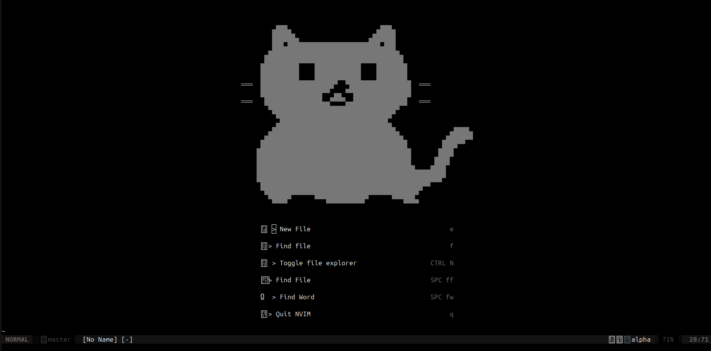
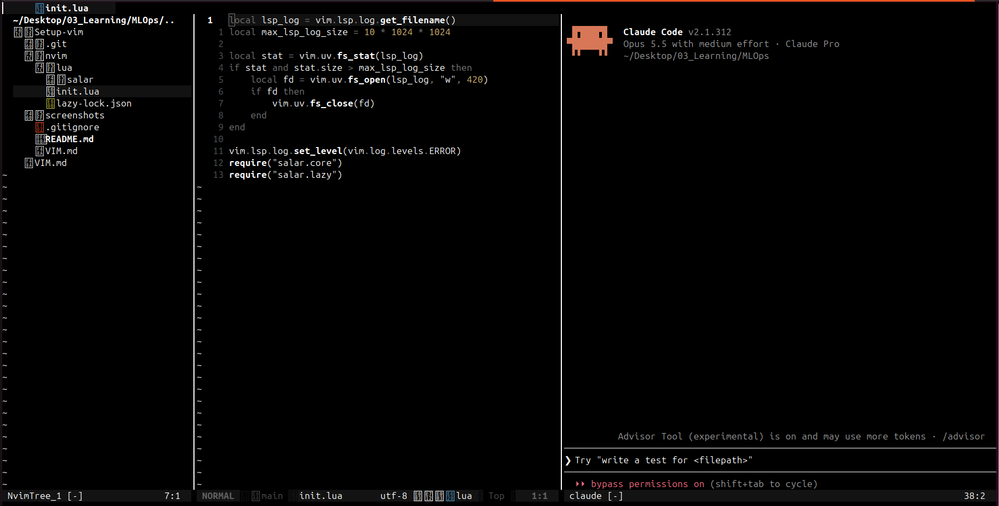
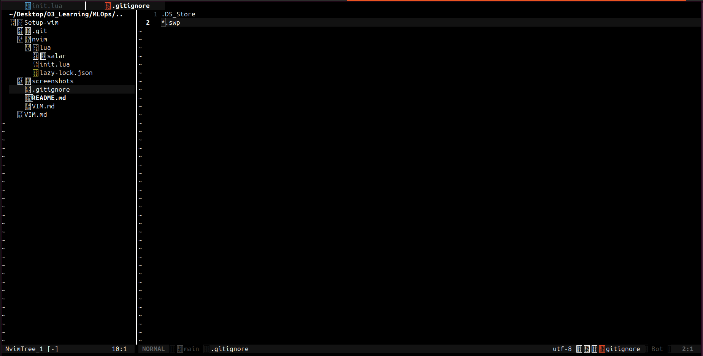
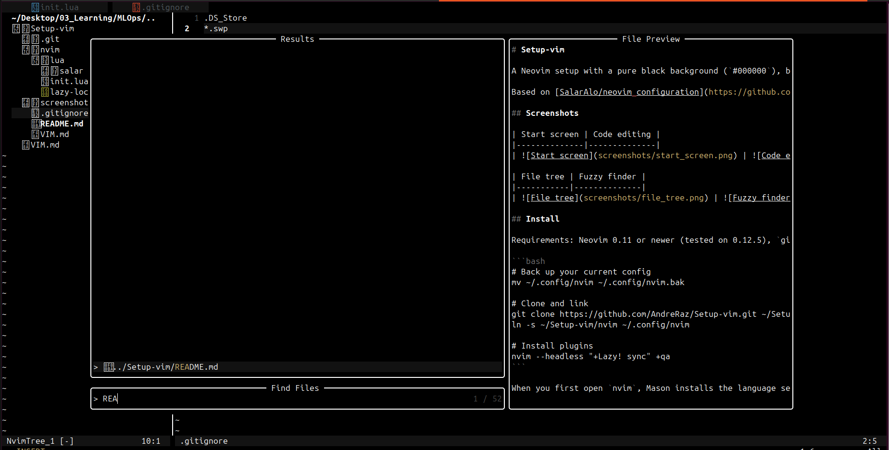

# Setup-vim

A Neovim setup with a pure black background (`#000000`), bright white text (`#ffffff`), and a chubby cat on the start screen. It covers Python, C/C++, light frontend work, Obsidian notes, and terminal AI agents (Claude Code, Codex, Pi).

Based on [SalarAlo/neovim_configuration](https://github.com/SalarAlo/neovim_configuration). I removed the Godot, Haskell, Typst, and Discord parts and added my own languages and tools.

## Screenshots

| Start screen | Code editing |
|--------------|--------------|
|  |  |

| File tree | Fuzzy finder |
|-----------|--------------|
|  |  |

## Install

Requirements: Neovim 0.11 or newer (tested on 0.12.5), `git`, a C compiler, `ripgrep`, and a [Nerd Font](https://www.nerdfonts.com/) in your terminal.

```bash
# Back up your current config
mv ~/.config/nvim ~/.config/nvim.bak

# Clone and link
git clone https://github.com/AndreRaz/Setup-vim.git ~/Setup-vim
ln -s ~/Setup-vim/nvim ~/.config/nvim

# Install plugins
nvim --headless "+Lazy! sync" +qa
```

When you first open `nvim`, Mason installs the language servers in the background. Run `:Mason` to check progress.

## What's included

| Area | Tools |
|------|-------|
| Theme | `koda.nvim` set to pure black, plus a theme picker (`<Space>ts`) |
| UI | `alpha-nvim`, `nvim-tree`, `bufferline`, `lualine`, `telescope`, `snacks` |
| LSP | `clangd`, `pyright`, `ts_ls`, `html`, `cssls`, `lua_ls`, `marksman` via Mason |
| Editing | `nvim-cmp`, `LuaSnip`, `treesitter`, `nvim-surround`, `mini.move`, `autopairs` |
| Debugging | `nvim-dap` with `dap-ui` for C, C++, and Python |
| Notes | `obsidian.nvim` and `render-markdown.nvim` |
| AI agents | `sidekick.nvim` for Claude Code (`<Space>ac`), Codex (`<Space>ax`), and Pi (`<Space>ai`) |
| C++ helpers | `:Skel`, `:CppTrvCtr`, `:CppExtractDefinitions`, and automatic `#include` sorting on save |

## Obsidian vaults

You can set your vault paths with environment variables:

```bash
export OBSIDIAN_VAULT_PERSONAL=~/Documents/Obsidian
export OBSIDIAN_VAULT_WORK=~/Obsidian
```

The config also finds any parent folder that contains `.obsidian`.

## Keybindings

[VIM.md](VIM.md) lists every shortcut (in Spanish), from basic motions to LSP, Telescope, Obsidian, DAP, and the AI agents. The leader key is `Space`.
